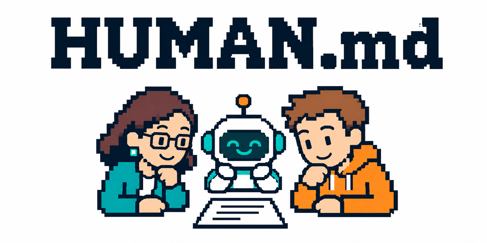
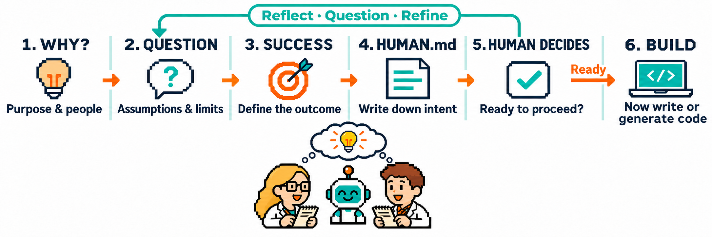

<p align="center">
  
</p>

<p align="center">
  <a href="https://github.com/Kylo1110/HUMANmd/blob/main/LICENSE"></a>
  <a href="https://github.com/Kylo1110/HUMANmd/blob/main/pyproject.toml"></a>
  <a href="https://github.com/Kylo1110/HUMANmd/blob/main/pyproject.toml"></a>
  <a href="https://github.com/Kylo1110/HUMANmd/blob/main/docs/cli.md#errors-and-safety"></a>
</p>

<p align="center">
  <a href="https://github.com/Kylo1110/HUMANmd#get-started">Get started</a> ·
  <a href="https://github.com/Kylo1110/HUMANmd/blob/main/docs/specification.md">Specification</a> ·
  <a href="https://github.com/Kylo1110/HUMANmd/blob/main/docs/agent-integration.md">Agent guidance</a> ·
  <a href="https://github.com/Kylo1110/HUMANmd#contributing">Contribute</a>
</p>

## Code explains how. HUMAN.md explains why.

HUMAN.md is an invitation to think deliberately before building, and to keep thinking as a project develops. Ask why the work matters, what you hope to achieve, and which assumptions you want to test. A small, human-owned Markdown file gives the important parts of that reflection a home, so collaborators, AI agents, and your future self can understand how the direction developed.

A few honest sentences can be enough. Templates, headings, and Decision Logs are optional: adapt them as the project develops, leave questions open, and add detail when it helps. HUMAN.md keeps the reasoning alongside your code and existing documentation.

## A note from the creators

In a world that keeps moving faster, we want to make a little room to slow down and collect our thoughts. Take a pen or an iPad, make a cup of coffee or tea, and think about what you want your project to achieve. We hope it can become a small fireplace for you and your team—a place to gather your thoughts, question assumptions, and return as the project develops.

**There is no perfect structure to fill in. Give the thinking a place to happen.**

Agents can help us explore and challenge ideas, while we remain responsible for directing their work, reviewing the results, and how we use the code. A [recent study of repository-level context files](https://arxiv.org/html/2602.11988v3) found that they did not generally improve coding agents' task success. For us, that's a reminder to focus HUMAN.md on making human intent explicit, rather than adding documentation for its own sake.

HUMAN.md is an evolving idea. We don't claim it's a proven solution or the right fit for every project, and we invite you to help shape it. Our [creator's note](https://github.com/Kylo1110/HUMANmd/blob/main/HUMAN.md#a-note-from-the-creator) shares the personal thinking behind the idea.

## Before the first line of code

**Start with a reason for the next step.**

<p align="center">
  
</p>

**Your first step may be an experiment. Write down what you want to learn before asking an agent to build it.**

The diagram offers a starting point, with room to revisit questions, assumptions, and intended outcomes. An exhaustive plan isn't required. As you experiment, implement, and maintain the project, explain what you learn and why the approach changes.

HUMAN.md follows three simple principles:

1. Human ownership. People define the purpose and remain responsible for the work.
2. Agent awareness. Give agents context to question assumptions and ask before changing direction.
3. Evolving reasoning. Record meaningful changes in understanding, not every code change.

## One file. A different purpose.

Your README may already explain why the project exists. HUMAN.md offers a dedicated home when it helps to keep ideas, assumptions, and decisions together. Link to existing explanations rather than duplicating them. These roles can overlap:

| File | Purpose |
| --- | --- |
| `README.md` | What the project does and how to use it. |
| `AGENTS.md` | How AI agents should work in the project. |
| `CHANGELOG.md` | What changed in the software. |
| `HUMAN.md` | Why the project exists, what it aims to achieve, and how its reasoning evolves. |

## Get started

Use the optional CLI to copy a template, or start writing a Markdown file yourself.

### Option 1 — Use the CLI

Requires [uv](https://docs.astral.sh/uv/getting-started/installation/) and Python 3.10+. Install the CLI, then initialize a file inside your project's existing directory:

```bash
uv tool install humanmd
humanmd init
```

Choose a template:

```bash
humanmd init --template research
```

List templates or get help:

```bash
humanmd templates
humanmd --help
```

The installed CLI works offline, has no runtime dependencies, and never overwrites an existing `HUMAN.md`. The target directory must already exist.

**The CLI offers a starting point. You provide the thinking.**

### Option 2 — Just use Markdown

No installation is needed. Create a `HUMAN.md` in your project root and start writing about its purpose, goals, and assumptions:

```markdown
# HUMAN.md

## Why?
Why does this project exist?

## What?
What are we trying to achieve?

## How will we know?
What would success look like?
```

You can also begin with a Creator's note explaining what brought you to the project. No sections are mandatory; see the [voluntary specification](https://github.com/Kylo1110/HUMANmd/blob/main/docs/specification.md).

<details>
<summary>A small example: organizing research experiments</summary>

This fictional example shows the kind of reasoning you might write. Its success criteria are proposed, not measured results.

```markdown
# HUMAN.md

## Why?
Our experiment notes are scattered across folders. We want to understand
earlier experiments without reconstructing their context from memory.

## What?
A lightweight local tool for researchers to group notes and link artifacts,
without uploading unpublished data.

## How will we know?
In a trial, a researcher should be able to record an experiment in under
two minutes and find its purpose, parameters, and artifacts a week later.
```

See the [full software example](https://github.com/Kylo1110/HUMANmd/blob/main/examples/software-project/HUMAN.md) for constraints and an initial decision.

</details>

## Choose a starting point

Different projects begin with different questions.

| Template | Best for |
| --- | --- |
| [Minimal](https://github.com/Kylo1110/HUMANmd/blob/main/src/humanmd/templates/minimal.md) | Purpose, goals, and success criteria. |
| [Research](https://github.com/Kylo1110/HUMANmd/blob/main/src/humanmd/templates/research.md) | Research questions, hypotheses, data, and evaluation. |
| [Software](https://github.com/Kylo1110/HUMANmd/blob/main/src/humanmd/templates/software.md) | Problems, users, constraints, and desired outcomes. |
| [Exploration](https://github.com/Kylo1110/HUMANmd/blob/main/src/humanmd/templates/exploration.md) | Early ideas, assumptions, and experiments. |

All four templates can be adapted and include an optional Creator's note. See the [Creator's note guidance](https://github.com/Kylo1110/HUMANmd/blob/main/docs/specification.md#creators-note-optional). See the fictional [research](https://github.com/Kylo1110/HUMANmd/blob/main/examples/research-project/HUMAN.md) and [software](https://github.com/Kylo1110/HUMANmd/blob/main/examples/software-project/HUMAN.md) examples.

## Give your AI agents context

Give agents the purpose as well as the task. Add this instruction to your `AGENTS.md` or equivalent agent configuration:

> Before implementation, read HUMAN.md. Treat it as the human-owned source of project intent. Use it to guide decisions. If a proposed change conflicts with documented goals or assumptions, ask for human approval. Suggest updates when new findings challenge the original reasoning.

HUMAN.md doesn't automatically enforce agent behavior, and the CLI doesn't modify agent instructions. See the [agent integration guide](https://github.com/Kylo1110/HUMANmd/blob/main/docs/agent-integration.md).

## When your thinking changes, write it down

When evidence challenges an assumption or a better approach emerges, explain what changed and why. You can revise a note, link to an experiment or discussion, or use an optional Decision Log like this:

```markdown
### 2026-11-08 — Markdown first

**Decision:** Keep the convention in ordinary Markdown
and the CLI dependency-free.

**Reason:** Intent should remain accessible without
a service or special tooling.

**Impact:** Anyone can adopt HUMAN.md with a single
file, even without installing the CLI.
```

Git preserves revisions; your explanations make the changes in reasoning understandable. Focus on what you learned and why the direction changed, without documenting every task, refactor, or bug fix.

## Contributing

HUMAN.md is an early open-source convention, and the goal is to keep it simple and useful. Contributions are welcome: improve a template, clarify the documentation, suggest better agent guidance, or share how you're using HUMAN.md. See [CONTRIBUTING.md](https://github.com/Kylo1110/HUMANmd/blob/main/CONTRIBUTING.md) and the [project philosophy](https://github.com/Kylo1110/HUMANmd/blob/main/docs/philosophy.md).

For CLI details and release preparation, see the [CLI guide](https://github.com/Kylo1110/HUMANmd/blob/main/docs/cli.md). Licensed under [MIT](https://github.com/Kylo1110/HUMANmd/blob/main/LICENSE).

## Thank you

Thank you to [@butterpear](https://github.com/butterpear), [@justinw98](https://github.com/justinw98), and [@sinwarmer](https://github.com/sinwarmer) for brainstorming and discussing this idea. Your questions and perspectives helped shape HUMAN.md.

<p align="center">
  
</p>

---

<p align="center">
  <em>What we build may change.</em><br>
  <em>The whys behind it remain.</em>
</p>

<p align="center">
  <em>To the humans behind the whys.</em>
</p>
